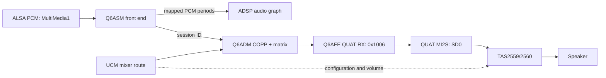

# Linux audio path on Poco F1 (Beryllium)

This note follows the SDM845 mainline-derived Linux tree at tag
`sdm845-6.18.2-r0` and its `alsa-ucm-conf` Beryllium profile. It records the
hardware route and protocol sequence to port independently to XNU. The Linux
ASoC/Q6DSP implementation is GPL; this document is a behavioral reference,
not code to copy into the APSL XNU tree.

## Board routes

The Beryllium common DTS describes two relevant playback backends:

- **Internal speaker:** Q6AFE `QUATERNARY_MI2S_RX` (`0x1006`) with SD0 only,
  routed through `q6routing` to the external TAS2559/TAS2560 smart amplifier.
  The sound node selects the QUAT MI2S and SD0 pinmux groups.
- **Wired headphones and analog capture:** WCD9340 through SLIMbus. The
  playback link uses `SLIMBUS_0_RX`; capture links use `SLIMBUS_0_TX` and
  `SLIMBUS_1_TX` for separate codec interfaces.

The DTS also declares Q6ASM Multimedia front ends and a Q6 Voice mode. Those
are distinct from the AFE backend: the AFE port alone is not a PCM stream and
cannot produce audio without a front end, ADM route, DMA buffers, codec or amp
configuration, and an iOS-facing audio provider.

## Linux QUAT MI2S startup

The Beryllium machine driver configures the QUAT CPU DAI as I2S with normal
bit/frame clock polarity. The CPU is the bit-clock and frame-clock provider;
the codec consumes those clocks. It programs the QUAT I-bit clock at
1,536,000 Hz using clock ID `0x106`.

Q6AFE then prepares the I2S port from the active PCM stream and DTS line mask:

- minor version `1`;
- bit width and sample rate from stream parameters;
- linear PCM (`0`);
- SD0 channel mode (`1`) from `qcom,sd-lines = <0>`;
- internal word-select source (`1`) when the CPU is clock provider;
- mono/stereo field from the stream's channel count;
- reserved field zero.

Linux does not use a fixed sample rate in the Beryllium DTS. For the XNU
control-plane smoke test, the chosen representative test vector is 48 kHz,
16-bit, stereo. That is an explicit test assumption, not a board constant.

Linux's packet order is:

1. Clock configuration: APR opcode `AFE_SVC_CMD_SET_PARAM` (`0x100f3`),
   per-port token 22, module `0x1028f`, parameter `0x10290`; payload is the
   20-byte
   clock structure: minor version 1, clock ID `0x106`, 1,536,000 Hz,
   attribute 1 (no coupling), root 0, enabled 1.
2. Port configuration: APR opcode `AFE_PORT_CMD_SET_PARAM_V2` (`0x100ef`),
   token 22, port `0x1006`, module `0x1020c`, parameter `0x1020d`.
3. Port start: APR opcode `AFE_PORT_CMD_DEVICE_START` (`0x100e5`), token 22,
   port `0x1006`.
4. On stream shutdown, `AFE_PORT_CMD_DEVICE_STOP` (`0x100e6`) is sent for
   port `0x1006`. The current Beryllium machine driver's QUAT shutdown branch
   does not send a clock-disable command; the first XNU smoke test follows
   that observed behavior and leaves the configured clock alone until DSP
   reboot.

For QUAT, token 22 follows the actual board call path:
`sdm845_snd_startup()` calls the QUAT DAI's `set_sysclk`, which reaches
`q6afe_port_set_sysclk()` and `q6afe_set_lpass_clock_v2()`; that wrapper uses
the port's token. The separate exported `q6afe_set_lpass_clock()` helper uses
the global clock token 1024, but the Beryllium QUAT startup path does not call
that helper. This distinction is easy to miss because both helpers send the
same service-level SET_PARAM opcode.

### ABI details that matter

The I2S structure contains 20 meaningful bytes. Linux stores it inside
`union afe_port_config`, whose largest member is the 36-byte TDM structure.
The union is zero-initialized and `q6afe_port_start()` passes
`sizeof(port->port_cfg)`, so the SET_PARAM_V2 parameter size is **36 bytes**:
20 I2S bytes followed by 16 zero bytes. The parameter header is 12 bytes and
the port command header is 16 bytes, making the complete APR packet 84 bytes
(20 + 16 + 12 + 36). The earlier 96-byte total was an arithmetic error.

Linux requests use a 20-byte APR header. The clock SET_PARAM uses a 16-byte
service command header, a 12-byte parameter header, and the 20-byte clock
structure: **68 bytes total**. The port SET_PARAM_V2 is 84 bytes total
(20-byte APR header + 16-byte port command header + 12-byte parameter header
+ 36-byte parameter). Device start and stop packets are **24 bytes total**
(20-byte APR header + 4-byte port command). Linux waits for and correlates an
APR basic-result response for each command. A DSP response can use a longer
APR v1 header; that does not change the request header length.

## What the XNU probe observed

The read-only `sweetadsp=4` probe established Q6Core firmware 2.8.0.0 and one
AFE API record `(service 4, API 2, branch 0)`. It sent a GET_PARAM_V2 query for
the QUAT I2S config. The DSP returned an 80-byte APR packet with status `2`
(`ADSP_EBADPARAM`); the response body included a zero parameter size and a
32-byte zero-filled output region. The current parser rejected that shape as a
length mismatch before reporting the status. This establishes that the query
was declined; it does **not** establish why, and it does not show that the
Linux SET_PARAM/start path is unsupported.

The important correction is that GET_PARAM is not part of Linux's port-start
path. Linux builds the configuration from the PCM stream and Beryllium DTS,
sets the clock, sends SET_PARAM_V2 with the full union, and starts the port.
The subsequent `sweetadsp=5` smoke test followed that sequence: the 68-byte
clock SET_PARAM, 84-byte QUAT SET_PARAM_V2, 24-byte DEVICE_START, and 24-byte
DEVICE_STOP each received APR basic-result `status=0` on the Poco F1
([CI build 41920592353](https://github.com/anxoCastro/Bergamota/actions/runs/41920592353)).
This confirms the AFE control lifecycle is accepted by the DSP. The test did
not send PCM, open ASM/ADM, configure the codec, or establish audible output.

## Linux speaker playback path

Linux splits playback across the ASoC front end and back end. Beryllium's DTS
connects the `MultiMedia1` front end to Q6ASM, and defines `Primary Spkr
Playback` with QUAT MI2S RX (`0x1006`), q6routing, and the TAS2559 codec. The
board selects the QUAT MI2S and SD0 pin groups. The UCM `HiFi.conf` enables the
`QUAT_MI2S_RX Audio Mixer MultiMedia1` route; its speaker profile selects TAS
configuration 4 and playback volume 35. Those mixer and amplifier settings
are separate from the AFE port configuration.

For PCM playback, `q6asm_dai_prepare()` first maps the PCM buffer into the DSP
shared-memory pool. Linux maps one contiguous region, rounds its size up to
4 KiB, and sends `ASM_CMD_SHARED_MEM_MAP_REGIONS` with
`ADSP_MEMORY_MAP_SHMEM8_4K_POOL` (pool ID `3`). The request contains one
address/size region and returns a memory-map handle. The DAI then sends
`OPEN_WRITE_V3`, registers the session with q6routing, and sends the
multi-channel PCM media-format block. `q6routing_stream_open()` opens an ADM
COPP for the selected output port and matrix-maps the ASM session to that
COPP. The ASM trigger sends RUN; on RUN completion Linux submits period-sized
`ASM_DATA_CMD_WRITE_V2` requests using the returned map handle, and continues
queuing periods as write-done events arrive. The AFE back-end DAI prepares the
stream parameters, sends the padded port configuration, and starts QUAT.
Shutdown stops the AFE port and closes/unmaps the ASM stream and its buffers.

The inherited SDM845 Q6ASM DAI node spells its Apps SMMU specifier as
`<&apps_smmu 0x1821 0x0>`. The Linux Q6ASM DAI reads the first cell, masks it
with `SID_MASK_DEFAULT` (`0xF`), and gets the value `1`; when IOMMU data is
present, it forms the DSP buffer address as
`dma_buffer.addr | (1ULL << 32)`. That local `sid` variable is the low-nibble
value encoded in the Q6ASM address. It must not be confused with the full
`0x1821` Apps SMMU stream matcher. XNU's existing `sweet_smmu_map_sid()` takes
the latter kind of hardware stream ID and installs an Apps SMMU mapping.
Passing `1` to that helper just because Linux calls its low-nibble value
`sid` would conflate two different fields.

Linux's Q6ASM DAI allocates its PCM buffer as a device DMA buffer, and its
device is attached to Apps SMMU stream `0x1821`. Thus `dma_buffer.addr` is the
DMA/IOMMU address supplied for that device; the DAI adds the stream's low
nibble in bits 32–35 before APR sends the address to ASM. A comparable XNU
implementation on Redwood confirms the split: the low address is an IOVA,
bits 32–35 carry the low nibble, and the full stream ID selects the Apps SMMU
translation. Its SMMU code maps each 4 KiB IOVA page to the kernel buffer's
physical page. This resolves the address format; the active Beryllium
SMR/S2CR state and a safe IOVA range still need a read-only hardware check.

XNU already has `sweet_smmu_map_sid()`, but it creates a shared identity map
for DRAM. That is not the per-buffer IOVA-to-physical mapping required by the
Linux Q6ASM address contract. Do not pass `1` to that helper or reuse the
Redwood port's fixed IOVA without checking Beryllium's DMA range.

The existing `sweet_smmu_probe_sid(sid, level)` helper is read-only: at level
0 it reports matching SMR/S2CR entries without changing the stream or a
context bank. The framebuffer diagnostics currently use it for display SIDs
`0x880` and `0xc80`; no `0x1821` observation has been captured yet. Reuse this
probe for the first Beryllium audio SMMU check instead of adding another raw
MMIO reader. Only after recording the current match should a later experiment
consider a dedicated translation for full stream `0x1821`; any existing
translated or fault mapping must remain untouched unless its ownership is
established.

Two implementation details make that probe important. First, the current
XNU `sweet_smmu_map_sid()` helper is not safe to call blindly for audio: when
it finds an exact, unmasked SMR for a SID, it changes that entry's S2CR to
point at XNU's shared identity-map context (unless it already points there).
It declines masked matches, but it can retarget an exact existing route. The
Q6ASM path needs per-buffer IOVA translations, so it needs an explicitly
owned mapping strategy that preserves and restores prior SMMU routing.

Second, a probe result of `0` means only that no valid SMR matched. The helper
also prints `sCR0.USFCFG`, which determines how an unmatched stream is handled;
it is not a classification from a default S2CR. Linux's ARM SMMU driver
initializes invalid SMRs and unassigned S2CRs to bypass unless
`CONFIG_ARM_SMMU_DISABLE_BYPASS_BY_DEFAULT` is enabled, and sets `USFCFG` to
fault unmatched streams under that option. Those are Linux initialization
rules, not evidence of the iOS boot's current state. Preserve the raw `sCR0`
observation and do not call an unmatched SID "bypass" without interpreting its
`USFCFG` bit.

The TAS2559 driver is another required layer: the DTS gives it I2C addresses
`0x4c`/`0x4d` and reset GPIOs, while the driver loads its firmware and exposes
the configuration and volume controls used by UCM. The DAI's pinmux and the
I2C amplifier setup must both work for speaker output. This route is distinct
from the WCD9340/SLIMbus route used by headphones and microphones.

## Cross-port XNU reference: HakiOS Redwood audio

The public HakiOS Redwood implementation separates the audio path into four
bring-up levels: AFE pins/clock; ASM + ADM plus a finite test tone with the
amplifiers off; the same tone with the amplifiers enabled; then iOS output
through a userland audio plug-in. Its `redwood_sound.c` uses the same Q6ASM
shared-memory map, `OPEN_WRITE_V3`, ADM COPP open/matrix map, PCM format,
RUN, WRITE_V2 periods and write-done event cycle described above. This is a
useful sequencing reference for the next Beryllium stage: prove SMMU + ASM +
ADM with the TAS amplifiers kept off before testing the speaker path.

That code also makes the memory relationship concrete. Redwood's DSP stream
is `0x1801`; its Android device tree supplies a fixed IOVA pool at
`0x10000000`. The XNU driver builds a dedicated Apps SMMU context and maps
that IOVA window page by page to its kernel buffer, then sends
`IOVA | (1ULL << 32)` to Q6ASM. The low nibble `1` is the DSP-side address
field; `0x1801` is the SMMU stream matcher. Redwood first checks existing
ownership: if the stream is already in bypass, it keeps that mapping and uses
the buffer's physical address only after confirming every page is contiguous;
if the stream has a translated or fault mapping, or a candidate context is
already active, it stops without taking it over. When it installs its own
translation, it first reserves an invalid SMR and an unused context bank and
refuses a candidate bank whose `SCTLR.M` is already set. It restores the prior
SMR/S2CR routing and prior context-bank enable state on shutdown; the
now-disabled candidate bank's programmed table registers remain in place.
Beryllium uses stream `0x1821`, and the audited
Linux DTS does not declare Redwood's fixed IOVA pool, so both the stream and
allocation range need to come from Beryllium's own state.

For the iOS boundary, HakiOS's `AudioServerPlugIn` presents a speaker device
to the audio server and writes its mixed 48 kHz, stereo PCM to a kernel
character device. A kernel ring buffer decouples the real-time userland writer
from the DSP's period/write-done cadence. That is a practical architecture
reference, while plugin loading, routing UIDs and buffer format still need to
be checked against this iOS 26 image. The Redwood amplifier and TDM constants
are device-specific and do not apply to Beryllium's TAS2559 + QUAT MI2S path.

## XNU port boundary and later stages

The first Linux-faithful XNU experiment is an explicit boot-arg-only AFE
control-plane smoke test. It checks correlated success responses for clock
setup, QUAT configuration, start, and stop. It sends no PCM data and does not
open Q6ASM/Q6ADM, configure WCD9340 or TAS firmware, manipulate GPIO/pinctrl,
or expose an iOS audio device. The test vector may enable the QUAT clock and
port, but it must never be described as audible playback.

The next actual-playback milestone is to resolve and record the Linux/Q6ASM
DMA-address and Apps SMMU mapping contract, then port the ASM map/open/format
lifecycle, the ADM COPP open/matrix map, and the period write/run loop. It
must then add the Beryllium QUAT pinmux, TAS I2C/GPIO and firmware/configuration
path, and an iOS 26 AudioServerPlugIn/HAL bridge. The current XNU AFE lifecycle
test supplies none of those layers. The headphone/microphone path additionally
requires WCD9340 and SLIMbus support.
Linux's working topology is a source reference, not evidence that any of
these paths already work in XNU.

## Primary source references

- [Beryllium common DTS](https://gitlab.com/sdm845-mainline/linux/-/blob/sdm845-6.18.2-r0/arch/arm64/boot/dts/qcom/sdm845-xiaomi-beryllium-common.dtsi)
- [SDM845 SoC DTS, including the Q6ASM DAI Apps SMMU specifier](https://gitlab.com/sdm845-mainline/linux/-/blob/sdm845-6.18.2-r0/arch/arm64/boot/dts/qcom/sdm845.dtsi)
- [Q6AFE core driver](https://gitlab.com/sdm845-mainline/linux/-/blob/sdm845-6.18.2-r0/sound/soc/qcom/qdsp6/q6afe.c)
- [Q6AFE DAI driver](https://gitlab.com/sdm845-mainline/linux/-/blob/sdm845-6.18.2-r0/sound/soc/qcom/qdsp6/q6afe-dai.c)
- [SDM845 machine driver](https://gitlab.com/sdm845-mainline/linux/-/blob/sdm845-6.18.2-r0/sound/soc/qcom/sdm845.c)
- [Q6ASM DAI driver](https://gitlab.com/sdm845-mainline/linux/-/blob/sdm845-6.18.2-r0/sound/soc/qcom/qdsp6/q6asm-dai.c)
- [Q6ASM APR core driver](https://gitlab.com/sdm845-mainline/linux/-/blob/sdm845-6.18.2-r0/sound/soc/qcom/qdsp6/q6asm.c)
- [Q6ADM driver](https://gitlab.com/sdm845-mainline/linux/-/blob/sdm845-6.18.2-r0/sound/soc/qcom/qdsp6/q6adm.c)
- [Q6 routing driver](https://gitlab.com/sdm845-mainline/linux/-/blob/sdm845-6.18.2-r0/sound/soc/qcom/qdsp6/q6routing.c)
- [ARM SMMU v1/v2 driver](https://gitlab.com/sdm845-mainline/linux/-/blob/sdm845-6.18.2-r0/drivers/iommu/arm/arm-smmu/arm-smmu.c)
- [Beryllium ALSA UCM profile](https://gitlab.com/sdm845-mainline/alsa-ucm-conf/-/blob/sdm845-phones/ucm2/Xiaomi/beryllium/HiFi.conf)
- [HakiOS Redwood Q6AFE/Q6ASM/Q6ADM + SMMU path](https://github.com/superboyyy/hakios-arm64e-dada/blob/main/base/xnu/files/bsd/dev/redwood_sound.c)
- [HakiOS Redwood iOS AudioServerPlugIn](https://github.com/superboyyy/hakios-arm64e-dada/blob/main/userland/userland/src/audio_plugin.c)
- [HakiOS Redwood kernel audio sink and character device](https://github.com/superboyyy/hakios-arm64e-dada/blob/main/base/xnu/files/bsd/dev/redwood_audio.c)
- [Bergamota XNU shared identity-mapping SMMU helper](../../xnu/patches-12377/0094-beryllium-usb-guctl1-smmu.patch)
