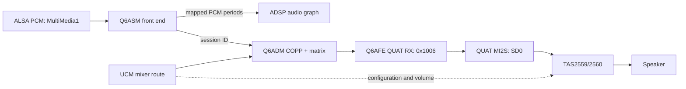

# Linux audio path on Poco F1 (Beryllium)

This note follows the SDM845 mainline-derived Linux tree at tag
`sdm845-6.18.2-r0` and its `alsa-ucm-conf` Beryllium profile. It records the
hardware route and protocol sequence to port independently to XNU. The Linux
ASoC/Q6DSP implementation is GPL; this document is a behavioral reference,
not code to copy into the APSL XNU tree.

## Board routes

The Beryllium common DTS describes two relevant playback backends:

- **Internal speaker:** Q6AFE `QUATERNARY_MI2S_RX` (`0x1006`) with SD0 only,
  routed through `q6routing` to the external TAS2559/TAS2560 smart amplifier.
  The sound node selects the QUAT MI2S and SD0 pinmux groups.
- **Wired headphones and analog capture:** WCD9340 through SLIMbus. The
  playback link uses `SLIMBUS_0_RX`; capture links use `SLIMBUS_0_TX` and
  `SLIMBUS_1_TX` for separate codec interfaces.

The DTS also declares Q6ASM Multimedia front ends and a Q6 Voice mode. Those
are distinct from the AFE backend: the AFE port alone is not a PCM stream and
cannot produce audio without a front end, ADM route, DMA buffers, codec or amp
configuration, and an iOS-facing audio provider.

## Linux QUAT MI2S startup

The Beryllium machine driver configures the QUAT CPU DAI as I2S with normal
bit/frame clock polarity. The CPU is the bit-clock and frame-clock provider;
the codec consumes those clocks. It programs the QUAT I-bit clock at
1,536,000 Hz using clock ID `0x106`.

Q6AFE then prepares the I2S port from the active PCM stream and DTS line mask:

- minor version `1`;
- bit width and sample rate from stream parameters;
- linear PCM (`0`);
- SD0 channel mode (`1`) from `qcom,sd-lines = <0>`;
- internal word-select source (`1`) when the CPU is clock provider;
- mono/stereo field from the stream's channel count;
- reserved field zero.

Linux does not use a fixed sample rate in the Beryllium DTS. For the XNU
control-plane smoke test, the chosen representative test vector is 48 kHz,
16-bit, stereo. That is an explicit test assumption, not a board constant.

Linux's packet order is:

1. Clock configuration: APR opcode `AFE_SVC_CMD_SET_PARAM` (`0x100f3`),
   per-port token 22, module `0x1028f`, parameter `0x10290`; payload is the
   20-byte
   clock structure: minor version 1, clock ID `0x106`, 1,536,000 Hz,
   attribute 1 (no coupling), root 0, enabled 1.
2. Port configuration: APR opcode `AFE_PORT_CMD_SET_PARAM_V2` (`0x100ef`),
   token 22, port `0x1006`, module `0x1020c`, parameter `0x1020d`.
3. Port start: APR opcode `AFE_PORT_CMD_DEVICE_START` (`0x100e5`), token 22,
   port `0x1006`.
4. On stream shutdown, `AFE_PORT_CMD_DEVICE_STOP` (`0x100e6`) is sent for
   port `0x1006`. The current Beryllium machine driver's QUAT shutdown branch
   does not send a clock-disable command; the first XNU smoke test follows
   that observed behavior and leaves the configured clock alone until DSP
   reboot.

For QUAT, token 22 follows the actual board call path:
`sdm845_snd_startup()` calls the QUAT DAI's `set_sysclk`, which reaches
`q6afe_port_set_sysclk()` and `q6afe_set_lpass_clock_v2()`; that wrapper uses
the port's token. The separate exported `q6afe_set_lpass_clock()` helper uses
the global clock token 1024, but the Beryllium QUAT startup path does not call
that helper. This distinction is easy to miss because both helpers send the
same service-level SET_PARAM opcode.

### ABI details that matter

The I2S structure contains 20 meaningful bytes. Linux stores it inside
`union afe_port_config`, whose largest member is the 36-byte TDM structure.
The union is zero-initialized and `q6afe_port_start()` passes
`sizeof(port->port_cfg)`, so the SET_PARAM_V2 parameter size is **36 bytes**:
20 I2S bytes followed by 16 zero bytes. The parameter header is 12 bytes and
the port command header is 16 bytes, making the complete APR packet 84 bytes
(20 + 16 + 12 + 36). The earlier 96-byte total was an arithmetic error.

Linux requests use a 20-byte APR header. The clock SET_PARAM uses a 16-byte
service command header, a 12-byte parameter header, and the 20-byte clock
structure: **68 bytes total**. The port SET_PARAM_V2 is 84 bytes total
(20-byte APR header + 16-byte port command header + 12-byte parameter header
+ 36-byte parameter). Device start and stop packets are **24 bytes total**
(20-byte APR header + 4-byte port command). Linux waits for and correlates an
APR basic-result response for each command. A DSP response can use a longer
APR v1 header; that does not change the request header length.

## What the XNU probe observed

The read-only `sweetadsp=4` probe established Q6Core firmware 2.8.0.0 and one
AFE API record `(service 4, API 2, branch 0)`. It sent a GET_PARAM_V2 query for
the QUAT I2S config. The DSP returned an 80-byte APR packet with status `2`
(`ADSP_EBADPARAM`); the response body included a zero parameter size and a
32-byte zero-filled output region. The current parser rejected that shape as a
length mismatch before reporting the status. This establishes that the query
was declined; it does **not** establish why, and it does not show that the
Linux SET_PARAM/start path is unsupported.

The important correction is that GET_PARAM is not part of Linux's port-start
path. Linux builds the configuration from the PCM stream and Beryllium DTS,
sets the clock, sends SET_PARAM_V2 with the full union, and starts the port.
The subsequent `sweetadsp=5` smoke test followed that sequence: the 68-byte
clock SET_PARAM, 84-byte QUAT SET_PARAM_V2, 24-byte DEVICE_START, and 24-byte
DEVICE_STOP each received APR basic-result `status=0` on the Poco F1
([CI build 41920592353](https://github.com/anxoCastro/Bergamota/actions/runs/41920592353)).
This confirms the AFE control lifecycle is accepted by the DSP. The test did
not send PCM, open ASM/ADM, configure the codec, or establish audible output.

## Linux speaker playback path

Linux splits playback across the ASoC front end and back end. Beryllium's DTS
connects the `MultiMedia1` front end to Q6ASM, and defines `Primary Spkr
Playback` with QUAT MI2S RX (`0x1006`), q6routing, and the TAS2559 codec. The
board selects the QUAT MI2S and SD0 pin groups. The UCM `HiFi.conf` enables the
`QUAT_MI2S_RX Audio Mixer MultiMedia1` route; its speaker profile selects TAS
configuration 4 and playback volume 35. Those mixer and amplifier settings
are separate from the AFE port configuration.

For PCM playback, `q6asm_dai_prepare()` first maps the PCM buffer into the DSP
shared-memory pool. Linux maps one contiguous region, rounds its size up to
4 KiB, and sends `ASM_CMD_SHARED_MEM_MAP_REGIONS` with
`ADSP_MEMORY_MAP_SHMEM8_4K_POOL` (pool ID `3`). The request contains one
address/size region and returns a memory-map handle; the Linux synchronous
command path waits up to five seconds for that response. The DAI then sends
`OPEN_WRITE_V3`, registers the session with q6routing, and sends the
multi-channel PCM media-format block. `q6routing_stream_open()` opens an ADM
COPP for the selected output port and matrix-maps the ASM session to that
COPP. The ASM trigger sends RUN; on RUN completion Linux submits period-sized
`ASM_DATA_CMD_WRITE_V2` requests using the returned map handle, and continues
queuing periods as write-done events arrive. The AFE back-end DAI prepares the
stream parameters, sends the padded port configuration, and starts QUAT.
Shutdown stops the AFE port and closes/unmaps the ASM stream and its buffers.

### MultiMedia1 ASM and ADM packet contract

The Linux ASM DAI first allocates the audio client with frontend DAI ID 0;
`q6asm_audio_client_alloc()` stores session ID 1. The DAI then explicitly
sets the DSP stream ID to 1. Consequently, OPEN/format/RUN/WRITE stream
headers use ports `0x101` and synchronous command token 1. The playback
shared-memory map uses token `(1 << 8) | 0 = 0x100` and zero source/destination
ports.

For a 48 kHz, signed 16-bit stereo test, Linux uses four 4,800-byte periods.
It maps their 19,200-byte allocation rounded up to 20,480 bytes in one
pool-3 region. The 40-byte map request carries the DSP DMA address
`0x0000000110000000`: IOVA `0x10000000` plus the low SID nibble `1` in bits
32–35. Its `0x10d93` response carries the memory-map handle in its first
payload word. The subsequent Linux packet sizes are 36 bytes for
`OPEN_WRITE_V3`, 44 for `MEDIA_FMT_UPDATE_V2`, 32 for `RUN_V2`, and 52 for
each `WRITE_V2`. Each write has its own period address, map handle, size and
sequence ID; the corresponding `WRITE_DONE_V2` event reports the completed
address in its first two payload words.

Two read-only XNU mode-7 boots on 2026-11-05 captured the Beryllium ASM map
reply as a 36-byte APR packet. Both have `hdr_field=0x0181`, declaring an
8-word (32-byte) header; the remaining four bytes are the nonzero map handle
`0xb0a93fb8`. The route is ASM service 7, ADSP domain 4 to ASM service 7, APPS
domain 5, and the opcode is `0x10d93`. The request token was `0x100`, while the
first response used token `1` and the second echoed `0x100`; all other parsed
fields and the handle matched. The first parser revision rejected both shapes
because it expected an 8-byte result. Linux's APR router advances the payload
by the declared header size and Q6ASM consumes the first 32-bit payload word as
the map handle; see the pinned [`apr.c`](https://gitlab.com/sdm845-mainline/linux/-/blob/sdm845-6.18.2-r0/drivers/soc/qcom/apr.c), [`apr.h`](https://gitlab.com/sdm845-mainline/linux/-/blob/sdm845-6.18.2-r0/include/linux/soc/qcom/apr.h), and [`q6asm.c`](https://gitlab.com/sdm845-mainline/linux/-/blob/sdm845-6.18.2-r0/sound/soc/qcom/qdsp6/q6asm.c). XNU accepts this exact ASM-map response shape only for the single outstanding map request and only with one of those two observed token values. Treat the token variation as a Beryllium observation, not a general APR rule.

q6routing opens the QUAT device in ADM with playback path 1, endpoint
`0x1006`, logical AFE port 22, NULL COPP topology `0x10312`, 2 channels,
16-bit samples and 48 kHz. The open request is 48 bytes; its response provides
the COPP ID. The RX matrix route is a 36-byte `MATRIX_MAP_ROUTINGS_V5`
request containing ASM session 1 and that COPP ID. Linux zero-allocates
ASM/ADM APR packets, so service and domain bytes 4–11 are initially zero.
Before sending, `apr_send_pkt()` fills the wire header with source service 7 or
8, source domain APPS (5), destination service 7 or 8, and destination domain
ADSP (4). A raw GLINK sender must reproduce this APR transport step; forwarding
the zeroed packet directly leaves the command unrouted. The AFE encoders in
this port already include those fields. The mode-5 Q6Core response advertised
ASM service 7/API 1.0 and ADM service 8/API 2.0 once each. A later ASM/ADM
mode should reject missing, duplicate, or different-version service records
before sending data.

A read-only Beryllium RAM boot on 2026-11-05 captured the 40-byte ADM open
response. Its 32-byte APR header has the expected reversed ADM route, token
`0x00160000`, and response opcode `0x10329`; the 8-byte result is all zeroes,
so status is 0 and the returned COPP ID is 0. The pinned Linux `q6adm.c`
defines only `0xff` as `INVALID_COPP_ID` and stores any other returned ID,
including 0. The prior XNU parser, matrix-map encoder, ADM-close encoder and
mode-7 caller rejected 0, so the captured success response stopped the route
before its matrix-map command. Patch 1180 aligns those checks with Linux,
continues to reject `0xff`, and keeps the response status/reserved-word checks.

The next read-only RAM boot with patch 1180 confirmed that the zero COPP ID
works through the RX matrix route and ASM PCM-format command. The DSP also
acknowledged the QUAT clock, I2S configuration and AFE `DEVICE_START`, all
with status 0. The following `ASM RUN_V2` was stopped by XNU's local GLINK TX
validation before it reached the DSP; the current trace does not establish a
RUN response or audible output. Both TAS reset GPIOs remained low during this
probe, keeping the amplifiers disabled.

The Linux APR receive path dispatches a response using its `dest_svc` field to
the registered service callback. On the return path, an ASM response therefore
needs service 7 and domains ADSP (4) to APPS (5); ADM uses service 8 with the
same domain direction. The already validated Q6Core response uses that reversed
route. XNU's first ASM/ADM reply parser incorrectly required bytes 4–5 and 8–9
to remain zero, which would reject a correctly routed reply. Patch 1177 checks
the expected service and return domains for map, open, WRITE_DONE and basic
result responses. This diagnosis follows Linux's APR send/receive dispatch and
the validated Q6Core header; the next Poco boot must still confirm the actual
ASM reply bytes. See the pinned [APR transport send path](https://gitlab.com/sdm845-mainline/linux/-/blob/sdm845-6.18.2-r0/drivers/soc/qcom/apr.c#L55-79)
and [APR receive dispatch](https://gitlab.com/sdm845-mainline/linux/-/blob/sdm845-6.18.2-r0/drivers/soc/qcom/apr.c#L190-265).

The inherited SDM845 Q6ASM DAI node spells its Apps SMMU specifier as
`<&apps_smmu 0x1821 0x0>`. The Linux Q6ASM DAI reads the first cell, masks it
with `SID_MASK_DEFAULT` (`0xF`), and gets the value `1`; when IOMMU data is
present, it forms the DSP buffer address as
`dma_buffer.addr | (1ULL << 32)`. That local `sid` variable is the low-nibble
value encoded in the Q6ASM address. It must not be confused with the full
`0x1821` Apps SMMU stream matcher. XNU's existing `sweet_smmu_map_sid()` takes
the latter kind of hardware stream ID and installs an Apps SMMU mapping.
Passing `1` to that helper just because Linux calls its low-nibble value
`sid` would conflate two different fields.

MultiMedia1's CPU DAI ID is 0, and Linux passes that as the audio-client
session selector; `q6asm_audio_client_alloc()` stores session ID 1. The DAI
then explicitly sets the DSP stream ID to 1. Thus OPEN/RUN/format stream
headers use source and destination port `0x101` and command token 1. For the
playback direction (`dir=0`), the separate shared-memory map token is
`(session << 8) | dir = 0x100`.

Linux's Q6ASM DAI allocates its PCM buffer as a device DMA buffer, and its
device is attached to Apps SMMU stream `0x1821`. Thus `dma_buffer.addr` is the
DMA/IOMMU address supplied for that device; the DAI adds the stream's low
nibble in bits 32–35 before APR sends the address to ASM. A comparable XNU
implementation on Redwood confirms the split: the low address is an IOVA,
bits 32–35 carry the low nibble, and the full stream ID selects the Apps SMMU
translation. Its SMMU code maps each 4 KiB IOVA page to the kernel buffer's
physical page.

The read-only Beryllium mode-6 probe has now observed `sCR0=0x210406`
(`USFCFG=1`, `GFIE=1`, `CLIENTPD=0`), `ID0=0x4c017e4c`, `ID1=0x5000002d`, 76
SMRs and 45 context banks, with no valid SMR matching full SID `0x1821`.
This is direct hardware evidence from the Poco F1; it does not show that the
unmatched route can safely bypass. Linux's ARM SMMU source interprets
`USFCFG=1` as faulting unmatched stream IDs, so the XNU test must install a
private translation before Q6ASM sees the DMA address. The same boot showed
context bank 3 used by a different stream and its shared identity map; do not
reuse CB3 for Q6ASM.

### Mode-7 context-bank TCR2

The mode-7 private mapping initially rejected context bank 4 because a write
of `TCR2=0x38002` read back as `0x38062`. ARM's SMMUv2 register definition
identifies bits 6 and 5 as `TBI1` and `TBI0`; they control whether the top byte
of a full 64-bit tagged input address participates in matching. The Q6ASM
address used here is below 2^36, so these top-byte controls do not change its
translation. The XNU readback check now ignores only those two bits while
continuing to check the other TCR2 fields and all other context-bank registers.

Comparing the initial value against the pinned Linux SMMU driver also found
that mode 7 omitted `TCR2.AS`. Linux sets this bit for an AArch64 context bank
after generating `SEP=7` and `PASize=2`; the corrected write is therefore
`0x38012`. Linux does not compare the TCR2 readback. In XNU, the saved TCR2 is
still restored and checked exactly. The 1173 RAM boot advanced through the
TCR2 comparison and later context-bank fields before stopping at ACTLR; the
remaining SCTLR readback and SMR/S2CR route still need hardware confirmation.

### Mode-7 context-bank ACTLR

The following RAM boot passed the TCR2 comparison and stopped at CB4 ACTLR
(`0x44004`): XNU expected `0`, while the register read back as `3`. In the
pinned Linux driver, `sdm845_smmu_500_data` has no `client_match` table, and the
ACTLR programming helper returns without writing when a table is absent. Linux
therefore leaves the SDM845 Apps SMMU ACTLR at its platform value. The observed
value `3` also matches the MMU-500 TRM reset settings for CPRE and CMTLB; it does
not establish that writes are locked.

The MMU-500 TRM says to modify ACTLR only during initialization and only while
`ACR.CACHE_LOCK` is clear. The private audio map now leaves ACTLR untouched,
keeps its saved value in the candidate-bank ownership snapshot, and checks that
it remains unchanged during restoration. It no longer writes ACTLR while
installing or restoring the context bank. The next boot must verify that setup
advances past the remaining context-bank readbacks before installing SMR/S2CR.

XNU already has `sweet_smmu_map_sid()`, but it creates a shared identity map
for DRAM. That is not the per-buffer IOVA-to-physical mapping required by the
Linux Q6ASM address contract. Do not pass `1` to that helper or reuse the
Redwood port's fixed IOVA without checking Beryllium's DMA range.

The existing `sweet_smmu_probe_sid(sid, level)` helper is read-only: at level
0 it reports matching SMR/S2CR entries without changing the stream or a
context bank. The framebuffer diagnostics also use it for display SIDs
`0x880` and `0xc80`. Mode 6 called it for `0x1821` and returned before PAS,
GLINK, APR, AFE, ASM, ADM or PCM startup. The capture reached `exec mount_hfs`;
it did not record `mount[3] exited`, a kernel panic or SpringBoard, so the
final screen state is unknown. The boot used a temporary read-only Fastboot
image and did not write a partition.

Two implementation details make that probe important. First, the current
XNU `sweet_smmu_map_sid()` helper is not safe to call blindly for audio: when
it finds an exact, unmasked SMR for a SID, it changes that entry's S2CR to
point at XNU's shared identity-map context (unless it already points there).
It declines masked matches, but it can retarget an exact existing route. The
Q6ASM path needs per-buffer IOVA translations, so it needs an explicitly
owned mapping strategy that preserves and restores prior SMMU routing.

Second, a probe result of `0` means only that no valid SMR matched. The helper
also prints `sCR0.USFCFG`, which determines how an unmatched stream is handled;
it is not a classification from a default S2CR. Linux's ARM SMMU driver
initializes invalid SMRs and unassigned S2CRs to bypass unless
`CONFIG_ARM_SMMU_DISABLE_BYPASS_BY_DEFAULT` is enabled, and sets `USFCFG` to
fault unmatched streams under that option. Those are Linux initialization
rules, not evidence of the iOS boot's current state. Preserve the raw `sCR0`
observation and do not call an unmatched SID "bypass" without interpreting its
`USFCFG` bit.

The TAS2559 driver is another required layer: the DTS gives it I2C addresses
`0x4c`/`0x4d` and reset GPIOs, while the driver loads its firmware and exposes
the configuration and volume controls used by UCM. The DAI's pinmux and the
I2C amplifier setup must both work for speaker output. This route is distinct
from the WCD9340/SLIMbus route used by headphones and microphones.

### TAS reset GPIO mapping for the first XNU tone test

The Beryllium DTS assigns the TAS2559/TAS2560 reset lines to TLMM GPIOs 12 and
76. The TI datasheet identifies `/RESET` as active-low, so the opt-in XNU
transport test drives both physical lines low and keeps them low; it does not
configure the amplifiers over I2C or attempt playback through their power
stages. The DTS property itself records the GPIO numbers; reset polarity comes
from the TI device datasheet.

The SDM845 pinctrl table places GPIO 12 in the SOUTH region and GPIO 76 in the
EAST region. Its register macro uses region base + `0x1000 * gpio` for the
configuration register and adds 4 for the I/O register. With the TLMM base at
`0x03400000`, the mode-7 driver maps GPIO 12's window from `0x03d00000` and
GPIO 76's from `0x03500000`; GPIO 76 is not in NORTH. This mapping was checked
against the `sdm845-6.18.2-r0` pinctrl source after catching the earlier
NORTH assumption in a test-first check.

## Cross-port XNU reference: HakiOS Redwood audio

The public HakiOS Redwood implementation separates the audio path into four
bring-up levels: AFE pins/clock; ASM + ADM plus a finite test tone with the
amplifiers off; the same tone with the amplifiers enabled; then iOS output
through a userland audio plug-in. Its `redwood_sound.c` uses the same Q6ASM
shared-memory map, `OPEN_WRITE_V3`, ADM COPP open/matrix map, PCM format,
RUN, WRITE_V2 periods and write-done event cycle described above. This is a
useful sequencing reference for the next Beryllium stage: prove SMMU + ASM +
ADM with the TAS amplifiers kept off before testing the speaker path.

That code also makes the memory relationship concrete. Redwood's DSP stream
is `0x1801`; its Android device tree supplies a fixed IOVA pool at
`0x10000000`. The XNU driver builds a dedicated Apps SMMU context and maps
that IOVA window page by page to its kernel buffer, then sends
`IOVA | (1ULL << 32)` to Q6ASM. The low nibble `1` is the DSP-side address
field; `0x1801` is the SMMU stream matcher. Redwood first checks existing
ownership: if the stream is already in bypass, it keeps that mapping and uses
the buffer's physical address only after confirming every page is contiguous;
if the stream has a translated or fault mapping, or a candidate context is
already active, it stops without taking it over. When it installs its own
translation, it first reserves an invalid SMR and an unused context bank and
refuses a candidate bank whose `SCTLR.M` is already set. It restores the prior
SMR/S2CR routing and prior context-bank enable state on shutdown; the
now-disabled candidate bank's programmed table registers remain in place.
Beryllium uses stream `0x1821`, and the audited
Linux DTS does not declare Redwood's fixed IOVA pool, so both the stream and
allocation range need to come from Beryllium's own state.

For the iOS boundary, HakiOS's `AudioServerPlugIn` presents a speaker device
to the audio server and writes its mixed 48 kHz, stereo PCM to a kernel
character device. A kernel ring buffer decouples the real-time userland writer
from the DSP's period/write-done cadence. That is a practical architecture
reference, while plugin loading, routing UIDs and buffer format still need to
be checked against this iOS 26 image. The Redwood amplifier and TDM constants
are device-specific and do not apply to Beryllium's TAS2559 + QUAT MI2S path.

## XNU port boundary and later stages

The completed `sweetadsp=5` XNU smoke test is an explicit boot-arg-only AFE
control-plane test. It checks correlated success responses for clock setup,
QUAT configuration, start, and stop. It sends no PCM data and does not open
Q6ASM/Q6ADM, configure WCD9340 or TAS firmware, manipulate GPIO/pinctrl, or
expose an iOS audio device. The test vector may enable the QUAT clock and
port, but it is not audible playback.

Patch 1170 now adds an opt-in bounded Linux-style PCM route: it maps a
19,200-byte four-period buffer rounded to 20,480 bytes in ASM pool 3, opens
MultiMedia1 (session 1/stream 1), opens and matrix-maps the ADM QUAT COPP, sets
48 kHz/S16/stereo, and waits for four 25 ms WRITE_V2 completions. ASM/ADM use
zeroed APR service/domain fields; the AFE requests retain the verified AFE
service/domain fields. Local host tests and ordered replay pass. This patch
still needs the GitHub kernel build and a read-only phone boot. Even a complete
APR/SMMU test would not prove audible playback because the TAS amplifiers stay
in reset. After the transport stage, bring up pinmux and TAS configuration
separately, then investigate an iOS 26 AudioServerPlugIn/HAL bridge. The
headphone and microphone route additionally requires WCD9340 and SLIMbus
support.
Linux's working topology is a source reference, not evidence that any of
these paths already work in XNU.

### XNU patches 1168–1169: local implementation status

Commit `3fe9c344` adds the Linux ASM/ADM request encoders and bounded response
parsers. The helper contract fixes MultiMedia1 to session 1 / DSP stream 1,
stream ports `0x101`, map token `0x100`, pool 3, and a 20,480-byte region for
four 4,800-byte periods.

Commit `a814e6f` adds `sweet_smmu_audio_map_buffer()` and
`sweet_smmu_audio_restore_mapping()` in the XNU SMMU driver. The helper rejects
any existing exact or masked `0x1821` match, counts all translating S2CR
references (including entries whose SMR is invalid), requires a free SMR and
an unreferenced context bank with `SCTLR.M=0`, then re-reads that state before
its first write. It saves the selected SMR/S2CR and context-bank configuration;
it never invokes the shared identity mapper or touches CB3. Its private
39-bit, 4 KiB stage-1 tables map five pages from IOVA `0x10000000` to the
contiguous 20 KiB PCM buffer. Allocation uses XNU `PAGE_SIZE` rounding so the
three hardware tables remain valid when XNU pages are larger than 4 KiB.

The host fake-MMIO fixture passes collision, ownership-change, install,
restore, and five-page descriptor checks. The full host suite passed 57/57.
These commits have not yet completed a GitHub kernel build or a phone boot;
the Linux host lacks `clang` and `xcrun`. Fastboot currently reports one
unlocked `beryllium` device. Treat the hardware mapping as unverified until
mode 7 is built and tested.

## Primary source references

- [Beryllium common DTS](https://gitlab.com/sdm845-mainline/linux/-/blob/sdm845-6.18.2-r0/arch/arm64/boot/dts/qcom/sdm845-xiaomi-beryllium-common.dtsi)
- [Beryllium TAS2559/TAS2560 reset GPIO declarations](https://github.com/Matheus-Garbelini/Kernel-Sphinx-Pocophone-F1/blob/master/arch/arm64/boot/dts/qcom/beryllium-p0.dtsi)
- [SDM845 pinctrl GPIO region offsets and GPIO 12/76 groups](https://gitlab.com/sdm845-mainline/linux/-/blob/sdm845-6.18.2-r0/drivers/pinctrl/qcom/pinctrl-sdm845.c)
- [SDM845 TLMM register base](https://gitlab.com/sdm845-mainline/linux/-/blob/sdm845-6.18.2-r0/arch/arm64/boot/dts/qcom/sdm845.dtsi)
- [TI TAS2559 datasheet](https://www.ti.com/lit/ds/symlink/tas2559.pdf)
- [SDM845 SoC DTS, including the Q6ASM DAI Apps SMMU specifier](https://gitlab.com/sdm845-mainline/linux/-/blob/sdm845-6.18.2-r0/arch/arm64/boot/dts/qcom/sdm845.dtsi)
- [Q6AFE core driver](https://gitlab.com/sdm845-mainline/linux/-/blob/sdm845-6.18.2-r0/sound/soc/qcom/qdsp6/q6afe.c)
- [Q6AFE DAI driver](https://gitlab.com/sdm845-mainline/linux/-/blob/sdm845-6.18.2-r0/sound/soc/qcom/qdsp6/q6afe-dai.c)
- [SDM845 machine driver](https://gitlab.com/sdm845-mainline/linux/-/blob/sdm845-6.18.2-r0/sound/soc/qcom/sdm845.c)
- [Q6ASM DAI driver](https://gitlab.com/sdm845-mainline/linux/-/blob/sdm845-6.18.2-r0/sound/soc/qcom/qdsp6/q6asm-dai.c)
- [Q6ASM APR core driver](https://gitlab.com/sdm845-mainline/linux/-/blob/sdm845-6.18.2-r0/sound/soc/qcom/qdsp6/q6asm.c)
- [APR transport driver, which fills service/domain routing fields](https://gitlab.com/sdm845-mainline/linux/-/blob/sdm845-6.18.2-r0/drivers/soc/qcom/apr.c)
- [Q6ADM driver](https://gitlab.com/sdm845-mainline/linux/-/blob/sdm845-6.18.2-r0/sound/soc/qcom/qdsp6/q6adm.c)
- [Q6 routing driver](https://gitlab.com/sdm845-mainline/linux/-/blob/sdm845-6.18.2-r0/sound/soc/qcom/qdsp6/q6routing.c)
- [ARM SMMU v1/v2 driver](https://gitlab.com/sdm845-mainline/linux/-/blob/sdm845-6.18.2-r0/drivers/iommu/arm/arm-smmu/arm-smmu.c)
- [ARM SMMUv2 architecture specification, TCR2 fields](https://documentation-service.arm.com/static/5f900d34f86e16515cdc08fb)
- [ARM CoreLink MMU-500 TRM, ACTLR usage and reset values](https://documentation-service.arm.com/static/5e908c8cc8052b1608761a37)
- [Pinned SDM845 Qualcomm SMMU driver](https://gitlab.com/sdm845-mainline/linux/-/blob/sdm845-6.18.2-r0/drivers/iommu/arm/arm-smmu/arm-smmu-qcom.c)
- [Beryllium ALSA UCM profile](https://gitlab.com/sdm845-mainline/alsa-ucm-conf/-/blob/sdm845-phones/ucm2/Xiaomi/beryllium/HiFi.conf)
- [HakiOS Redwood Q6AFE/Q6ASM/Q6ADM + SMMU path](https://github.com/superboyyy/hakios-arm64e-dada/blob/main/base/xnu/files/bsd/dev/redwood_sound.c)
- [HakiOS Redwood iOS AudioServerPlugIn](https://github.com/superboyyy/hakios-arm64e-dada/blob/main/userland/userland/src/audio_plugin.c)
- [HakiOS Redwood kernel audio sink and character device](https://github.com/superboyyy/hakios-arm64e-dada/blob/main/base/xnu/files/bsd/dev/redwood_audio.c)
- [Bergamota XNU shared identity-mapping SMMU helper](../../xnu/patches-12377/0094-beryllium-usb-guctl1-smmu.patch)
