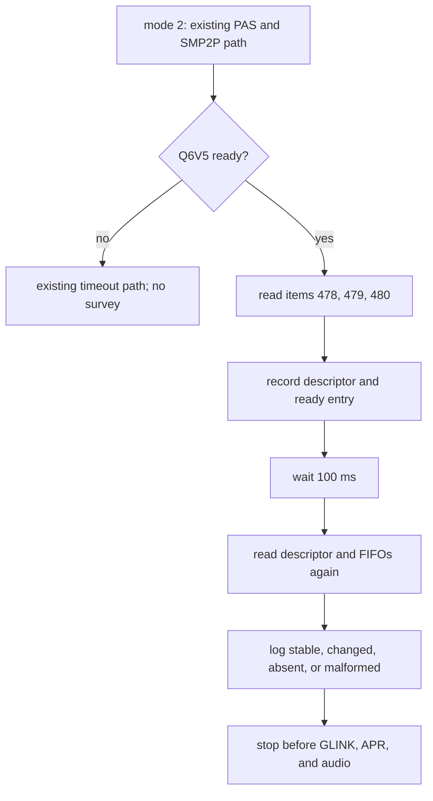

# Beryllium ADSP GLINK Read-Only Preflight Design

## Intent

The ADSP now reaches the Q6V5 ready branch on two patch-1147 RAM boots after the SMP2P version downgrade and mailbox bit-10 kick. The next question is whether GLINK-SMEM items 478–480 already exist and what state their descriptor and ring indices hold. This milestone will read and report that state after Q6V5 ready without starting GLINK or changing shared memory.

The result will tell the later GLINK startup design whether Beryllium's transport items are absent, malformed, idle-looking, or changing. A pair of equal snapshots is only evidence that the values did not change during the sample interval; it is not proof that the ADSP is inactive.

## Current evidence

- The repeated patch-1147 capture records PAS `INIT_IMAGE`, `MEM_SETUP`, and `AUTH_AND_RESET` success, all 14 segment readbacks, item-429 downgrade from v2 to v1, the mailbox bit-10 kick, negotiation completion, and `Q6V5 ready observed`.
- That capture does not contain a GLINK, APR, or audio operation. It does not show the runtime contents of items 478–480.
- The mode-2 ADSP driver already maps SMEM and has a bounded read-only private-item lookup for the Apps/ADSP host pair. It stops after Q6V5 ready and retains QMP/XO.
- Linux's SDM845 edge uses remote PID 2, IRQ 156, mailbox client 8, and channel `apr_audio_svc` ([pinned SDM845 DTS](https://github.com/torvalds/linux/blob/85f1df2a4ec71d7a91dd95a7a49f889d1595ffa8/arch/arm64/boot/dts/qcom/sdm845.dtsi)). Linux's generic GLINK-SMEM path uses descriptor item 478 and FIFO items 479/480. It accepts or allocates a 32-byte descriptor, accepts or allocates a 16 KiB TX FIFO, retrieves the RX FIFO lazily, resets the AP RX tail and TX head indices, then starts native GLINK negotiation and enables the edge IRQ ([pinned `qcom_glink_smem.c`](https://github.com/torvalds/linux/blob/85f1df2a4ec71d7a91dd95a7a49f889d1595ffa8/drivers/rpmsg/qcom_glink_smem.c)). Those writes are normal cold-start behavior, but the current XNU boot has no evidence that resetting the ring indices would be safe.
- HakiOS stages its ADSP work as a shared-memory survey, a GLINK queue read, and then a separate GLINK protocol step. Its processor IDs, mailbox values, memory map, and implementation are device-specific; it is a sequencing reference only ([HakiOS ADSP driver](https://github.com/oosexgang/hakios-xnu-kernel/blob/main/xnu/files/bsd/dev/hakios.adsp.c)).

## Goals

- After mode 2 reports Q6V5 ready, inspect items 478, 479, and 480 in the Apps/ADSP private SMEM partition using the existing bounded read path.
- If item 478 exists and is exactly 32 bytes, record the four Linux-defined ring indices: TX tail, TX head, RX tail, and RX head. Record whether each value is within the corresponding FIFO's reported size; do not assume alignment, ownership, or inactivity from one sample.
- Record each item's presence and reported size. Treat an absent item separately from malformed partition/item metadata.
- Take a second descriptor/index sample 100 ms after the first. Report which values stayed equal and which changed.
- Log the current `slave-kernel` entry name/value when Q6V5 ready is observed, so the successful state transition has direct runtime evidence.
- On malformed or unavailable items, log a bounded reason and return from the survey while allowing boot to continue.
- Keep the operation opt-in under the existing `sweetadsp=2` mode. Ordinary boot and mode 1 remain unchanged.

## Non-goals

- Do not allocate SMEM items, initialize or reset indices, write descriptor/FIFO bytes, or ring mailbox client 8.
- Do not register or enable GIC SPI 156, start a GLINK worker, negotiate GLINK version/features, open a channel, advertise intents, or send APR packets.
- Do not write remote-owned SMP2P item 443, issue PAS `SHUTDOWN`, or change PAS/QMP/XO behavior.
- Do not reuse or refactor the modem's `IPCRTR` state/transport in this milestone.
- Do not probe AFE/ASM/ADM, codec registers, SLIMbus, MI2S, amplifiers, PCM, capture, or audio routes.
- Do not claim that stable zero indices prove the transport is inactive or that a valid Q6V5 ready state proves GLINK is initialized.

## Approaches considered

1. **Start Linux-style GLINK and APR after Q6V5 ready.** This reaches an end-to-end service query sooner, but Linux resets two local ring indices before sending the version command. With live Beryllium indices and endpoint ownership unknown, that combines observation and mutation and makes a failed handshake hard to diagnose.
2. **Generalize the existing MPSS GLINK code for both modem and ADSP.** This may reduce duplicate protocol code later, but it changes a working modem transport while adding a second endpoint with a different remote PID, mailbox client, SMEM partition, and lifecycle.
3. **Add a bounded read-only ADSP transport survey first.** This adds only observations to the existing mode-2 path and preserves the exact live ring state. It costs one capture before implementation of the GLINK handshake, but gives that implementation actual item sizes and before/after indices.

**Selected:** approach 3. This is the smallest milestone that answers the current hardware unknown without adopting Linux cold-start writes or coupling the ADSP to the modem driver. A later, separate design will specify GLINK allocation/initialization and transport negotiation based on the survey.

## Design

### Entry point and ordering

Call a new read-only survey from the existing mode-2 startup path only after the driver has logged Q6V5 ready. Run it before returning from the ADSP probe. Do not change the PAS sequence or move the current GLINK/APR boundary.

Use the already mapped SMEM region and the existing private-item lookup for hosts 0 and 2. The survey must not call the private-item allocator or acquire the TCSR allocation lock, because it does not alter the allocation list.

### Item handling

| Item | Linux reference | Survey behavior |
|---|---|---|
| 478 | GLINK descriptor, expected 32 bytes | If present, require exactly 32 bytes before reading the first four 32-bit indices. If absent or a different size, log and do not interpret bytes. |
| 479 | AP TX FIFO; Linux allocates 16 KiB if absent | Read and report presence/size only. |
| 480 | AP RX FIFO; Linux retrieves it lazily | Read and report presence/size only. Absence is not an error for this survey. |

For a valid descriptor, use the Linux field mapping: word 0 TX tail, word 1 TX head, word 2 RX tail, word 3 RX head. Check TX indices against item 479's reported size and RX indices against item 480's reported size only when those FIFOs exist and have nonzero size. An out-of-range value is logged as invalid and is never repaired. Do not infer that a field is safe to modify based on this mapping.

The private-item lookup must distinguish `FOUND`, `ABSENT`, and `MALFORMED` outcomes rather than making the survey infer status from log text. `ABSENT` is valid only after both uncached and cached lists have been checked. Require the partition header size to equal the TOC entry size and validate both free offsets before scanning. Keep the result bounded; do not return a pointer to an unchecked item.

### Sampling and logs

Read each item through the existing bounded SMEM parser, with the same access attributes and barriers used by the current ADSP snapshot. For each descriptor sample, read words 0–3 twice with a barrier between passes. If the two passes differ, mark that sample `unstable` and do not interpret its indices. This is a bounded best-effort check, not an atomic snapshot guarantee. Emit one summary for sample 1, wait 100 ms, and emit sample 2. Keep the output bounded to item presence/sizes, four descriptor indices, range checks, and the ready entry name/value; do not dump unrelated SMEM or log raw physical addresses.

If the descriptor or any source metadata changes in a way that invalidates a sample, log `malformed` or `changed` and stop interpreting it. If the four indices differ within one sample, log `unstable sample`; if valid samples differ across the 100 ms interval, log `changed between samples`. Neither result proves the edge is fully active. If valid samples are unchanged, report `stable during 100 ms`; do not label the edge idle or safe to reset.

### Failure behavior

The survey is diagnostic. Missing items, malformed sizes, invalid indices, or an unstable descriptor must not panic the kernel or change the ADSP state. Q6V5 timeout behavior remains as it is today, and the survey runs only after the ready path succeeds.

## Acceptance criteria

- With `sweetadsp=2`, after Q6V5 ready, logs show item presence/size for 478–480 and two bounded descriptor/index samples 100 ms apart when item 478 is valid.
- The ready log includes the `slave-kernel` entry value that caused the ready branch.
- Absent items, wrong descriptor size, an out-of-range index, or changing indices produce diagnostic output and no memory writes.
- Source and regression coverage prove the survey calls no allocator, write helper, mailbox-8 doorbell, GIC-156 setup, GLINK parser, or APR path.
- A KDK-enabled XNU 26.5 build succeeds. A temporary `fastboot boot` of the root-read-only image reproduces the Q6V5 ready result and captures the survey; no partition or GPT is written.
- Ordinary boot and mode 1 behavior remain unchanged. No GLINK/APR handshake or audio operation is claimed.

## Constraints and licensing

- Keep implementation in the Beryllium ADSP driver patch series and keep the ADSP state separate from MPSS.
- Use Linux to confirm wire layout and operation ordering, and HakiOS only as a design reference. Write an independent XNU implementation; do not copy Linux GPL code into this APSL tree.
- Keep device dumps, serials, and firmware outside Git. Record exact build/boot/capture results in `NOTES.md`.
